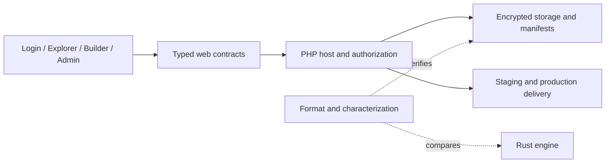

# EFSDB

**Encrypted file storage, a PHP runtime, and a browser workspace for inspecting and publishing what you build.**

[Project intent](INTENT.md) · [Agent guide](AGENTS.md) · [Security and modernization plan](docs/MODERNIZATION.md)

Files, application state, and published sites usually acquire separate storage and administration systems. EFSDB explores a common foundation: encrypted storage with an explicit format, permission-aware views of the same data, and a workspace that can turn selected content into a public site.

The PHP reference runtime hosts the application. Svelte powers login, Explorer, Builder, and administration. Rust provides a separate engine and conformance surface. The useful engineering question is whether those boundaries can stay understandable and testable as the system grows.

**Current status:** an experimental reference implementation with active security hardening work. The [October 2026 review](docs/MODERNIZATION.md) identifies open authorization, public-file delivery, and concurrent-worker issues. Use disposable demo data and a patched PHP runtime; production acceptance remains open.

## What to explore

| Surface | What it demonstrates | Source |
| --- | --- | --- |
| Encrypted storage | Canonical manifests, chunk storage, indexing, and explicit format contracts | `efsdb/php/core/src`, `spec/FORMAT.md` |
| Explorer | Natural/raw views and permission-aware file operations | `web/apps/explorer`, `web/contracts` |
| Builder | Staging/production workspaces and public-site delivery | `web/apps/builder`, `PublicWorkspace.php`, `PublicSiteRouter.php` |
| Administration | Roles, settings, shared window shells, and operational views | `web/apps/admin`, `web/ui`, `web/styles` |
| Conformance | PHP characterization and PHP/Rust behavior comparisons | `spec/characterization`, `efsdb/php/conformance`, `efsdb-core` |



The current public delivery default is `php-html`. Imported [SvelteKit PHP](https://github.com/ryanspice/sveltekit-php) output is limited to static-prerender delivery; generic SSR and action parity need separate acceptance.

## Start contributing

Read [INTENT.md](INTENT.md), then [AGENTS.md](AGENTS.md). Choose one bounded task from the update plan, claim its files, check the behavior, and return a focused patch or authorized commit with evidence. The lead owns integration and acceptance.

The shared convention is five files: this README, `AGENTS.md`, `INTENT.md`, `docs/MODERNIZATION.md`, and `repo.schema.json`. Source paths stay in place. Runtime data, credentials, private conversations, and mutable fleet receipts stay outside public repository material.

On October 23, 2026, this workspace's CLI resolved to PHP 8.5.4. Verify and update the actual serving runtime before exposing the application to untrusted requests. PHP's October 21 security fixes are in 8.5.12, 8.4.27, 8.3.36, and 8.2.35; vendor backports require vendor evidence. [PHP advisory](https://www.php.net/archive/2026.php#2026-10-21-5).

<details>
<summary>Local setup, source map, bootstrap, and verification commands</summary>


EFSDB is an encrypted file system database with canonical manifests, chunked encrypted storage, a PHP reference runtime, and a web control plane.

## Active Source Of Truth

- Runtime and host behavior:
  - `efsdb/php/core`
- Web apps:
  - `web/apps/login`
  - `web/apps/explorer`
  - `web/apps/builder`
  - `web/apps/admin`
- Shared typed web contracts:
  - `web/contracts/*.ts`
- Shared workstation UI and design tokens:
  - `web/ui`
  - `web/styles`
- Executable characterization and conformance:
  - `spec/characterization`
  - `efsdb/php/conformance`
- Active spec docs:
  - `spec/CURRENT_STATE.md`
  - `spec/FORMAT.md`
  - `spec/auth-contract.md`
  - `spec/CONFORMANCE.md`

Historical phase plans and retired drafts now live under `spec/archive`.

## Run The Demo

From the repo root:

```powershell
bun install
bun run build:web
bun run dev
```

`bun run build:web` rebuilds the Tailwind PHP shell and ships the active `login`, `explorer`, `builder`, and `admin` web bundles into [efsdb/php/core/public/js](efsdb/php/core/public/js). Search remains embedded inside the explorer bundle and is not shipped as a standalone host app. The native BLAKE3 extension must match the selected PHP ABI, architecture, and thread-safety mode; see the existing [extension build guide](docs/internal/blake3-extension-build-test.md).

Direct PHP startup still works:

```powershell
$env:EFSDB_ENV = "development"
php -c efsdb/php/core/php.ini -S 127.0.0.1:8787 -t efsdb/php/core/public
```

Useful overrides:

```powershell
$env:EFSDB_DATA_DIR = "./efsdb-data"
$env:EFSDB_BOOTSTRAP_SECRET = "replace-with-a-real-secret"
$env:EFSDB_DEBUG = "1"
```

Open [http://127.0.0.1:8787](http://127.0.0.1:8787).

## Bootstrap And Roles

- Development bootstraps on the first HTTP request.
- If `EFSDB_BOOTSTRAP_SECRET` is set, it becomes the initial `tenant_admin` login key.
- If no bootstrap secret is set, first initialization generates a one-time `tenant_admin` key and prints it to the server console once.
- If the data directory already exists, no new key is generated. Use `bun run tenant-admin-key` to rotate and print a fresh local demo key.
- Production requires `EFSDB_BOOTSTRAP_SECRET` or an explicit bootstrap CLI flow and fails closed without it.
- Seeded roles remain:
  - `operator_root`
  - `tenant_admin`
  - `member_premium`
  - `member_standard`
  - `guest`

## Verification

Core validation:

```powershell
bun run check
```

Individual checks:

```powershell
bun run check:api
bun run check:auth
bun run check:conformance:generate
bun run check:conformance
bun run web:typecheck
bun run web:test:ui
```

To keep CLI PHP execution aligned with the app runtime:

```powershell
powershell -ExecutionPolicy Bypass -File .\scripts\php-core.ps1 .\efsdb\php\core\bin\apicheck.php
```

Manual smoke test:

```powershell
$env:EFSDB_BOOTSTRAP_SECRET = "replace-with-your-tenant-admin-key"
powershell -ExecutionPolicy Bypass -File efsdb/php/core/bin/smoke.ps1
```

## Security Notes

- Runtime data and key material must live outside the served web root in production.
- Refresh tokens are hashed server-side and revoked or rotated on use.
- Login keys are stored only as password hashes inside encrypted documents.
- The conformance fixtures include a public test key for deterministic crypto checks. Do not reuse that key for real deployments.

## Docs

- [Current state](spec/CURRENT_STATE.md)
- [Format spec](spec/FORMAT.md)
- [Auth contract](spec/auth-contract.md)
- [Conformance checklist](spec/CONFORMANCE.md)
- [Web contract guide](web/contracts/README.md)
- [Archived phase docs](spec/archive/README.md)

</details>
